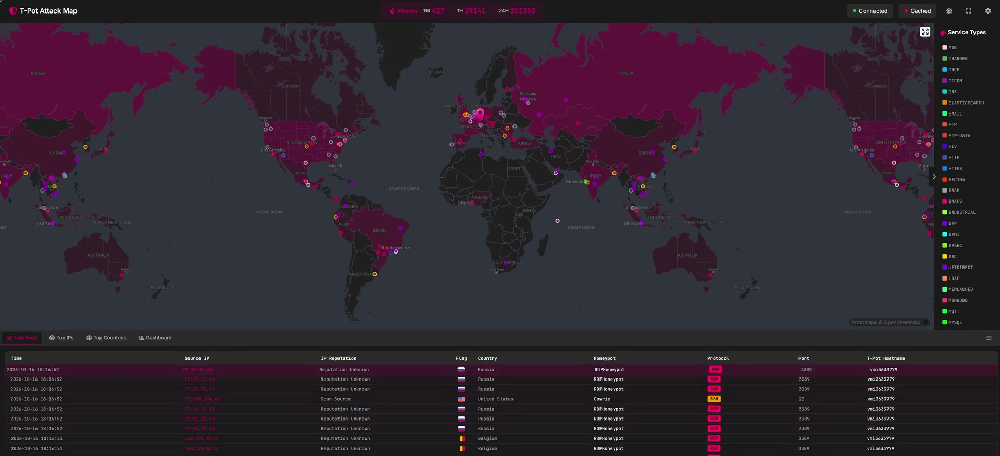

[Inicio](../../README.md) · [Blue Team](../README.md)

# 🍯 T-Pot · Estudio del comportamiento de atacantes

**Blue Team** · Proyecto de estudio · Vídeo demostrativo

**[▶ Ver la demostración con reproductor](https://w4ltersec.github.io/cybersecurity-labs/blue-team/t-pot/)**

## Objetivo

Estudiar cómo actúan los atacantes a partir de la actividad observada en T-Pot, identificar patrones y mejorar la detección temprana y la prevención.

## Demostración

La grabación muestra **T-Pot Attack Map**: el mapa de actividad, los tipos de servicio y una tabla con eventos. Su duración es de aproximadamente **31 segundos**.

El vídeo se publica con el nombre **T-Pot-demo.mp4**.

[Ver el proyecto visual](https://w4ltersec.github.io/cybersecurity-labs/blue-team/t-pot/) · [Abrir o descargar el vídeo](T-Pot-demo.mp4)

## Qué estudiar

| Observación | Pregunta de investigación |
| --- | --- |
| Distribución y concentración de conexiones | ¿Dónde se concentra la actividad observada y cómo evoluciona? |
| Protocolos y puertos objetivo | ¿Qué servicios aparecen con más frecuencia? |
| Repeticiones y secuencias de eventos | ¿Hay patrones que ayuden a priorizar la investigación? |

## De la observación a la defensa

1. **Observar:** identificar eventos y actividad relevantes.
2. **Relacionar:** comparar orígenes, servicios y secuencias.
3. **Investigar:** formular hipótesis y buscar evidencias.
4. **Validar:** probar ideas de detección y medidas defensivas en el laboratorio.

El proyecto se presenta como una demostración y un punto de partida para el estudio. Las detecciones y medidas propuestas deben contrastarse con evidencias y pruebas.

## Recursos

- [T-Pot: repositorio y documentación oficiales](https://github.com/telekom-security/tpotce).
- [Volver a los proyectos de Blue Team](../README.md).
